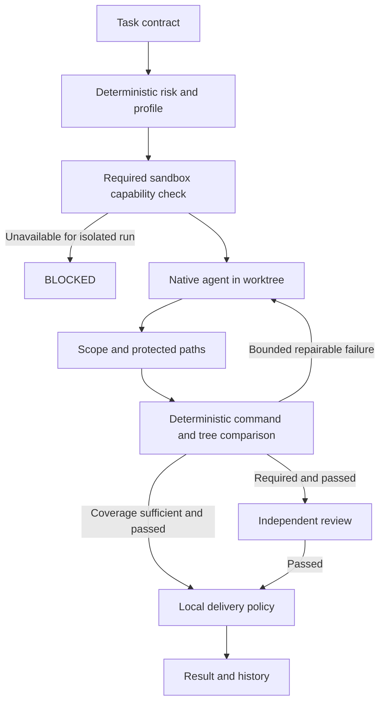

# Execution v2 architecture

Execution v2 uses the shared Node runner for Codex and Claude. It starts when the JSON input contains `contract`. The legacy Codex route and Claude Workflow remain available through their original inputs.



## Contract and routing

`scripts/task-contract.mjs` validates version `1` inputs. The caller supplies an ID, description, absolute repository, literal execution scope, and any acceptance criteria. The contract also accepts protected paths, declared effects, test-edit permission, coverage, complexity, and resource limits. The runner binds the repository to its actual Git root, rejects path escapes, and adds risk, selected profile, final status, and evidence references. The contract accepts no shell command or caller-supplied result.

Risk uses declared effects, sensitive task terms and paths, protected paths, configured network access, scope, and declared verification coverage. Complex work can require a higher profile without changing its risk. Missing scope requires caller input. A requested profile can raise the policy minimum. A host requirement for sandboxed verification raises the profile without changing risk. The risk assessment never reads sandbox probe results. Risk heuristics are conservative and can miss intent. Use explicit `effects`, coverage, and paths for authority decisions.

| Profile | Worker | Gate and review | Delivery |
| --- | --- | --- | --- |
| `DIRECT` | One native call on the first configured tier. | A trusted deterministic command must succeed. Complete coverage comes from the contract. | Apply a locally verified candidate to the checkout. |
| `MANAGED` | Native calls on the same tier for bounded repair. | Explicit acceptance and a successful command are required. Partial or unknown coverage, or complexity other than `small`, requires independent review. | Apply after mandatory checks and any required review. |
| `ISOLATED` | A scoped worktree and native Codex worker sandbox. | The required native verification sandbox must pass before execution and again at the command. Independent review is mandatory. | Retain the candidate as `REVIEW_REQUIRED` for independent CI and human approval. |

`scripts/codex-run.mjs` uses the leftmost configured model and effort. No model router or diagnosis call runs for v2. Codex uses `codex exec` with native structured output. Execution v2 disables Codex tool-network access and requests for escalation. Claude uses `claude --print` with JSON schema output, the native approvals configuration, a file-tool allowlist, and disabled MCP servers for the role. The worker can edit. The reviewer has read tools and receives a bounded patch excerpt to review. A reviewer must reject insufficient evidence. [Codex CLI](https://learn.chatgpt.com/docs/developer-commands), [Claude Code CLI](https://code.claude.com/docs/en/cli-reference)

## Verification and security boundary

The runner selects `verify` from the backend configuration or discovers an existing project check. The contract and any model output cannot replace that command. The caller must trust the selected repository and verify configuration. The runner checks changed paths against the literal contract scope, protected paths, and existing test and verification-input protections. Changes to files that were already dirty are measured against the captured dirty baseline. The runner uses a fresh candidate worktree for verification and compares the Git tree after the command and again after any review. A failed mandatory gate bypasses review.

Without required isolation, deterministic checks use the existing host shell. It can access host credentials and network resources. This path is for trusted projects and checks. Git worktrees share Git metadata and do not provide OS isolation. Scope checks govern delivery and do not sandbox tool execution. Native processes still depend on provider permissions and the host's configuration. In particular, a successful command sandbox probe establishes the verification boundary, while Codex worker tools use the native workspace sandbox. It does not certify that every backend tool is confined by the verification profile.

`ISOLATED` fails closed using the existing sandbox receipt and statuses. The implementation never falls back to a host command. Claude's isolated worker boundary has not been established and the runner blocks that combination. Windows native sandbox unavailability and unverified WSL2, Linux, and Docker behavior remain as recorded. No sandbox probe logic or smoke fixture changed for v2. [Sandbox validation](../audits/sandbox-validation.md)

## Evidence, failure, and delivery

The result and `.model-ladder/history.jsonl` record the contract, backend, model cell, changed paths, candidate tree, command provenance and exit code, sandbox controls, and review status. An attempt with a usable draft records `IMPLEMENTED` separately from its verification result. `VERIFIED` requires a successful mandatory command, an intact candidate, and any required review. Missing review output is `INCONCLUSIVE`. Unavailable policy or tooling blocks the run. Deterministic test failures can produce `FAILED`. A stale destination produces `CONFLICT`. High-risk success has a locally verified attempt and `REVIEW_REQUIRED` delivery. None of these states imply remote acceptance.

Only a repairable mandatory check failure seeds a retry with the scoped, unverified tree. The runner stops on the same candidate and exit code twice. Missing tools, sandbox denials, quota exhaustion, permission failures, context limits, and shutdown failures receive separate evidence and do not trigger model escalation. Calls are bounded by the contract attempts and time limit per invocation, subject to OS cleanup. Explicit continuation validates the original contract, checkout, configuration, protected paths and scope before reusing its checkpoint. `TERMINATION_FAILED` preserves its lock and workspace and offers no automatic continuation.

The existing apply mutex serializes delivery. Execution v2 compares the affected original files against the baseline under that mutex before applying the immutable candidate. Local opt-in commit configuration still applies to `DIRECT` and `MANAGED`. Isolated candidates are kept for external CI and approval. The existing GitHub workflow runs agent-independent tests. The runner never pushes, merges, deploys, or changes branch protection. `delivery.ci` remains `UNVERIFIED` until an external process supplies that evidence. The runner does not query remote checks or consume approval receipts.

## Usage and baseline

Telemetry records duration, attempts, and observed input, output, and cached input tokens for routing, workers, review, retries, and the total. Retry usage is a subset of stage usage. Missing fields or calls with incomplete usage produce `UNKNOWN`. A native reported `0` remains zero. Claude's inclusive input total uses uncached input and reported cache creation and reads. Backend token usage, cost, and subscription quota are separate. No model prompts or command output are added to the telemetry object. Existing operational logs and task evidence can still contain sensitive data. Success artifacts follow existing pruning rules. Compact history, held worktrees, and unconfirmed termination evidence are retained.

The local branch `execution-v2-baseline-20261119` points at `c31e53681e53cca92dd3d1fb6f2ae041208f179a`. Its parent is `98db16dcb4ae0b4b6f08e29f0b3682677a3115bf`. The branch captures the pre-change working tree without changing the checkout or its index. Historical benchmark code and results were preserved. A comparative benchmark was not run.

## Implementation files

- Contract and policy live in `scripts/task-contract.mjs`. Execution, scope gates, retries, delivery, and evidence share `scripts/codex-run.mjs`.
- `scripts/codex-exec.mjs` and `scripts/claude-exec.mjs` invoke the native runtimes. `scripts/common.mjs` retains held candidates and termination evidence during pruning.
- `tests/unit/task-contract.test.mjs`, `tests/unit/codex.test.mjs`, and `tests/helpers/fake-codex.mjs` exercise the contract and native-process boundaries.
- The Codex and Claude run skills accept explicit contract files. `README.md`, `DESIGN.md`, `USAGE.md`, and the migration guide document the entry point.

## Validation

Nine focused legacy tests passed before implementation. The following related offline suite passed 304 tests on Windows in a process context that permits `taskkill` to stop its own fixtures.

```powershell
$env:MODEL_LADDER_NO_UPDATE_CHECK = '1'
node --test tests/unit/task-contract.test.mjs tests/unit/codex.test.mjs tests/unit/codex-exec.test.mjs tests/unit/codex-worktree.test.mjs tests/unit/codex-split.test.mjs tests/unit/codex-usage.test.mjs tests/unit/codex-live.test.mjs tests/unit/config.test.mjs tests/unit/flow.test.mjs tests/unit/finish.test.mjs tests/unit/scripts.test.mjs tests/unit/runs.test.mjs tests/unit/handoff.test.mjs
```

The context-exhaustion checkpoint case and test-home isolation gate passed in a separate focused run. The project doctor, JavaScript syntax checks, and `git diff --check` also passed. Git object hashes match the baseline for the sandbox adapter, process-tree helper, sandbox smoke fixture, audit reports, and benchmark scripts and results.

The native CLI transport fixtures prove control flow and evidence handling. Authenticated native role execution, a real positive isolated run, Linux, and remote CI remain unverified.
