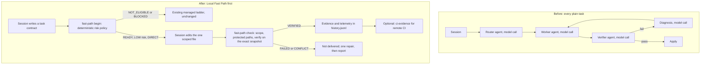

# Native-first workflow

model-ladder now has three paths. Each one reuses existing Execution v2 code and adds no service, router or agent framework.

- **Local Fast Path.** The calling Claude Code or Codex session is the native agent. It makes no extra model call.
- **Managed path.** This is the existing ladder or an Execution v2 contract, used when the policy does not select `DIRECT`.
- **Cloud Safe Path.** The session prepares a handoff and the person starts the official cloud agent. GitHub CI decides readiness.

## Before and after

| Path | Model calls started by model-ladder | Verification | Delivery |
| --- | --- | --- | --- |
| Before, legacy ladder | Router 1, worker 1 or more, verifier 1 or more, diagnosis per retry | Verifier agent and the verify command | Applied after verification |
| Local Fast Path | 0. The session's own edit is the only model work. | The trusted verify command on a clean worktree built from the checkout snapshot | Already in the checkout. `ci` stays `UNVERIFIED`. |
| Execution v2 `DIRECT` | Worker 1, router 0, reviewer 0 | Deterministic command | Applied locally |
| Execution v2 `MANAGED` | Worker 1 to N, reviewer only when coverage is incomplete or complexity is not `small` | Command, then a conditional review | Applied after the gates |

## Local Fast Path

`scripts/fast-path.mjs begin --input <contract.json>` runs these checks before any edit:

1. It parses the v2 contract.
2. It runs `taskPolicy` with the same protected patterns and sandbox requirement as the runner.
3. It finds the configured or discovered verify command.
4. It snapshots the checkout under the apply mutex.

Only a `LOW` risk `DIRECT` policy with no review is eligible: one file, `coverage: complete`, not `complex`, and no sensitive term, path, effect or protected path. Any other policy returns `NOT_ELIGIBLE`, and the skill continues with the unchanged ladder. A required verification sandbox also makes the task ineligible. The fast path never falls back to the host when a sandbox is required. `begin` also returns `BLOCKED` for these cases, and nothing is changed: an invalid contract or configuration, a missing verify command, an npm check that needs `node_modules`, an active ladder run in the repository (`ACTIVE_RUN`), or uncommitted changes (`DIRTY`, unless `allowDirty` is true).

`check --run <id>` runs these steps in order:

1. It rejects a moved `HEAD`.
2. It snapshots the checkout and rejects out-of-scope, contract-protected, test, verify-input and npm-script changes.
3. It runs the verify command in a clean worktree built from that snapshot.
4. It rejects verification that changed files.
5. It snapshots the checkout again and returns `CONFLICT` if the checkout changed while verification ran.

A failed check delivers nothing, and the draft stays in the checkout for one repair. A timeout is `INCONCLUSIVE`. Checks beyond `limits.maxAttempts` (default 2) return `ATTEMPTS_EXHAUSTED`. Each check appends one history line with v2-shaped evidence and telemetry.

Native tools reused: the host session's own edit tools, permissions and sandbox; `taskPolicy`, `usageEvidence`, `snapshot`, `changed`, `protectedChange`, `makeWorktree`, `processRun`, `discoverVerify`, `verifyProtection` and the apply mutex.

## Status

| Capability | Status | Evidence |
| --- | --- | --- |
| Fast path policy, scope, protected-path, snapshot and failure gates | VERIFIED (offline) | `tests/unit/native-first.test.mjs` |
| Fast path starts no router, worker process or reviewer | VERIFIED (offline) | Sentinel `CODEX_BINARY` and `CLAUDE_BINARY` never launched |
| Skill entry points for Claude Code and Codex | IMPLEMENTED | `skills/run/SKILL.md` step 0 and `codex-skills/model-ladder/SKILL.md`. No live session run. |
| Passive telemetry report | VERIFIED (offline and real history) | `scripts/telemetry.mjs`. See [passive telemetry](../telemetry/passive-telemetry.md). |
| GitHub CI evidence and delivery gate | PARTIALLY VERIFIED | Check runs were read live from the public repository. Branch protection needs a token and returned `UNKNOWN`. |
| Cloud handoff, Codex Cloud | PARTIALLY VERIFIED | `codex cloud exec --env` exists in Codex CLI 0.169.0 and is marked EXPERIMENTAL. No cloud task was started. |
| Cloud handoff, Claude Code | PARTIALLY VERIFIED | `claude --cloud` exists in Claude Code 2.1.318. No cloud session was started. |
| Cloud authentication, cloud PR creation, status tracking | UNAVAILABLE here | These need the person's sign-in and are outward-facing. They were not run. |
| Automatic cloud invocation, auto-fix, auto-merge | PLANNED, off | model-ladder never starts cloud tasks, merges, or pushes. |

## Cloud Safe Path

1. `node scripts/ci-evidence.mjs cloud` detects the official CLIs. Authentication is reported as `UNVERIFIED`.
2. `node scripts/ci-evidence.mjs handoff --input <contract.json> [--env <id>]` prints a brief and the official command. The command is `codex cloud exec --env <id> <brief>` or `claude --cloud <brief>`. The brief limits scope, asks for a pull request, and forbids merging, pushing to the default branch, and deploying. The person runs the command after signing in. Local credentials never go to a cloud worker; each service uses its own sign-in.
3. Track the task with `codex cloud status <task>` or the claude.ai/code session.
4. `node scripts/ci-evidence.mjs ci --ref <pr head> --branch <base>` reads GitHub check runs and required checks. `deliveryGate` is `READY` only when the local status is `VERIFIED`, CI is `PASS`, and no known required check is failing or pending. Unreadable CI is `UNKNOWN`, never a pass.

If no official cloud command exists, handoff returns `UNAVAILABLE`. A Codex handoff without an environment ID returns `BLOCKED` with `CLOUD_ENV_REQUIRED`.
